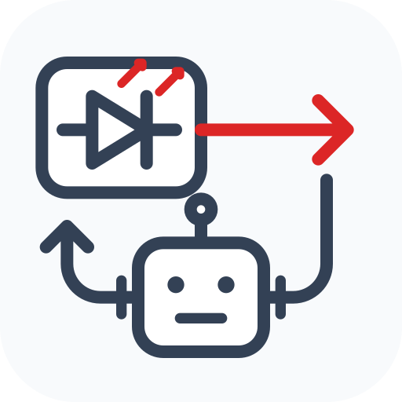

# LDCon

**Still in active development.**

Laser locking, characterization and a Web dashboard. **ECDL and DFB/DBR control
are implemented**, with digital-servo PI control and TOPTICA DLCpro adapters.

```sh
pip install "ldcon[web,instruments,analysis]"
ldcon-simulate --mode deterministic
ldcon-examples ./my-lab
```

Python 3.10+ on Linux. `experiment-core` installs automatically. Optional agent
messaging: `pip install "ldcon[agents]"` (installs `fanharvard-agentbridge`).
Provider CLIs and their authentication are separate.

Supported agent interfaces: **Claude Code, Codex and OpenCode**, with a DeepSeek
Harness adapter for card tasks.

**Agents** monitor results, diagnose problems and run bounded characterization,
parameter tuning and recovery through registered control cards. **Humans** choose
the experiment, target, hardware configuration and physical safety limits, and
authorize safety-relevant changes. The fast feedback loop runs on the controller;
the agent is not the real-time servo.

**Locking and quality:** wavemeter feedback drives PI control of ECDL piezo or
DFB/DBR current; slower temperature/current corrections and feedforward are
available where configured. Quality is reported using frequency error/stability,
mode hops, position-independent fringe secondary peaks/width and dither response.
Missing data remains unknown; quality labels are distinct from physical safety.

| Configuration | Hardware |
| --- | --- |
| ECDL / digital servo | Wavemeter and data feed, compatible digital servo/DAC, piezo driver, current/TEC controllers and supported AWGs (e.g. Siglent SDG) |
| DFB/DBR | Wavemeter, current/TEC controller (e.g. Thorlabs CLD1015); compatible digital servo/DAC and modulation input for native current PI |
| ECDL / DLCpro | TOPTICA DLCpro, wavemeter feedback; AWG/trigger connections for configured feedforward scans |
| Spectral quality / studies | Fringe image source for secondary-peak analysis; scope/telemetry and AWG where required by the selected measurement |

For digital-servo hardware and integration details, please contact
[kenjishu@fas.harvard.edu](mailto:kenjishu@fas.harvard.edu).

Tests use simulations, fake instruments and loopback services to cover control
contracts, owner exclusivity, uncertain writes, cancellation/recovery, tuning,
sweeps, configuration, quality reporting and Web behavior. They do not certify
a new physical setup. See [test suite](tests/).

[Bundled examples](src/ldcon/resources/examples/) include Sr422, Sr1092 and ThF685
laser definitions, decks and assignments, with output disabled and placeholder
connections. Installation starts no hardware or service and includes no credentials.
[Publishing](docs/publishing.html) · [MIT license](LICENSE)

FanHarvard site configuration and deployment: [ldcon-fanharvard](https://github.com/FanHarvard/ldcon-fanharvard).
